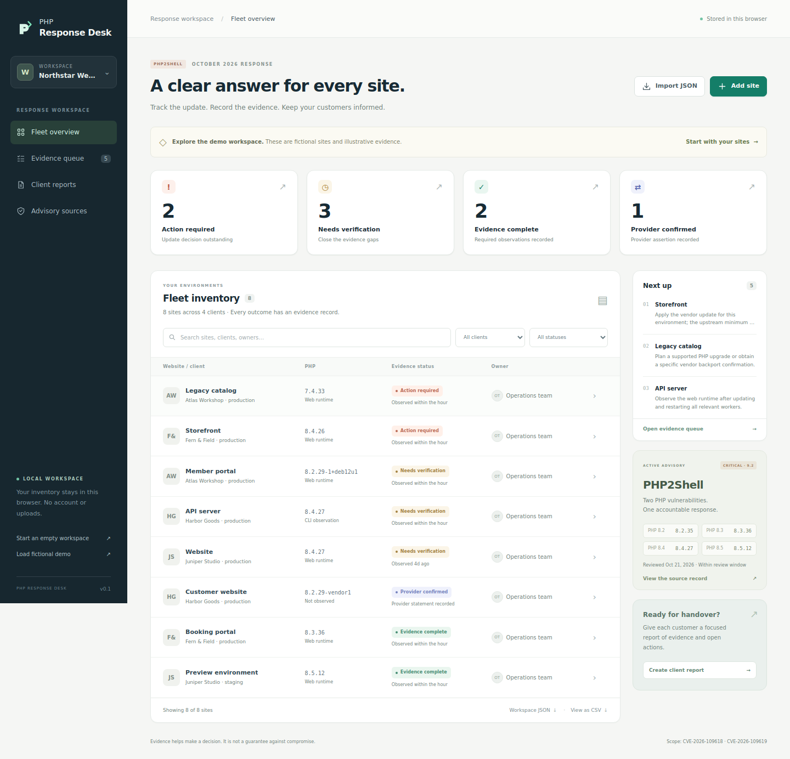

# PHP Response Desk

**Know who owns each PHP update, what evidence supports it, and what to tell the customer.**

A working local MVP for web agencies and managed service providers coordinating PHP security updates across customer environments. It combines a fleet dashboard, evidence review, an optional local collector, and portable customer reports.

[](https://github.com/tobiko-dev/php-global-crisis-fix/actions/workflows/ci.yml)



*The screenshot and bundled inventory are fictional. This repository documents a product and a proposed service; it does not claim customers, revenue, or production remediation.*

## The business problem

During an urgent PHP update, an agency needs a defensible answer for every customer site: who owns it, what evidence shows the update is active, and what remains to be done.

Provider behavior differs. [Laravel Forge states that its automatic security updates do not patch PHP](https://laravel.com/forge/docs/knowledge-base/php-security-release-october-2026). Vendor backports and persistent workers also mean that a version string needs context. [The PHP project's advisory](https://www.php.net/archive/2026.php) supplies the upstream baseline.

The first commercial hypothesis is a scoped verification service for agencies with several sites and uneven hosting support. The proposed **$150–300 single-server pilot is an unvalidated pricing experiment**. Scope, deliverables, discovery questions, and decision criteria are in [the business plan](docs/BUSINESS.md).

## Run it in two minutes

Requirements: **Node.js 20+**. There are **zero runtime package dependencies**; no package installation is needed. Python 3.9+ is optional for the collector.

```bash
git clone https://github.com/tobiko-dev/php-global-crisis-fix.git
cd php-global-crisis-fix
npm start
```

Open **http://127.0.0.1:4380**. The first visit loads eight labeled demo sites. Review a site, filter the evidence queue, or generate a customer report. Choose **Start an empty workspace** before entering real inventory. **Workspace JSON** exports a transferable working copy.

The server binds to loopback. Working data stays in the browser profile; there are no accounts or shared backend.

## What works

| Capability | Practical result |
|---|---|
| Fleet inventory | Track client, site, environment, provider, and owner. Search and filter by customer or outcome. |
| Evidence editor | Record PHP runtime provenance, reviewer, reference, worker restart, and application check. Preview the assessment while editing. |
| Provider confirmations | Keep a dated provider assertion covering both CVEs separate from runtime evidence. |
| JSON import/export | Replace a workspace or merge records by stable ID. Imported computed statuses are discarded and recalculated. |
| Customer reports | Download printable, self-contained HTML containing only the selected customer's records. |
| CSV export | Export the visible inventory with spreadsheet formula protection. |
| Command line | Assess JSON, create reports, filter a customer, and return a distinct exit code for unresolved work. |
| Local collector | Read CLI PHP metadata without a shell or PHP startup configuration. Uncertain observations remain unresolved. |

## The four outcomes

| Outcome | Meaning |
|---|---|
| **Action required** | A recognized upstream web-runtime observation is below the reviewed fixed release or on a legacy branch. |
| **Verification needed** | Evidence is missing, stale, inconsistent, unsupported, or insufficient. CLI and installed-package observations alone cannot establish the active web runtime. |
| **Evidence complete** | The recorded upstream web runtime, restart, application check, reviewer, and supporting evidence meet freshness and chronology rules. |
| **Provider confirmed** | A qualifying provider assertion covering both CVEs has been recorded, with a reviewer and reference. |

The last two outcomes describe operator-supplied evidence. They do not independently authenticate a provider, establish protection from every vulnerability, or prove absence of prior compromise.

The initial catalog covers **CVE-2026-109618 and CVE-2026-109619**, reviewed October 21, 2026. It expires **October 28, 2026 at 23:59:59 UTC**. Evidence has a 72-hour review policy. Expired catalogs cannot establish positive outcomes. Unknown branches, prereleases, and vendor backports require deliberate review. See [sources and maintenance policy](docs/SOURCES.md).

## Operator workflow

1. Establish the agreed customer environments and their owners.
2. Import collector JSON or enter observations, distinguishing the web runtime from CLI PHP and installed packages.
3. Obtain vendor/provider references and record the review, restart, runtime observation, and application check performed outside this tool.
4. Use the evidence queue to identify remaining work and its owner.
5. Export your inventory and a report scoped to the intended customer.

The [operator runbook](docs/RUNBOOK.md) explains the complete workflow.

### Generate a fictional report

```bash
npm run demo
```

Open `reports/demo.html` in a browser. CLI outputs are created exclusively; choose a new filename or deliberately move an older export before repeating a command.

### Collect a local CLI observation

Run this on a system you administer:

```bash
python3 collectors/collect.py \
  --id web-01 \
  --client 'Example Customer' \
  --name 'Customer website' \
  --out inventory.json
```

The collector uses `php -n -v`. This does not establish which runtime serves web requests or whether workers restarted. Missing PHP or failed observations remain unknown. The collector never patches a server.

### Assess and create a customer report

```bash
node bin/php-response.mjs assess inventory.json --format json --fail-on-open

node bin/php-response.mjs assess inventory.json \
  --format html \
  --client 'Example Customer' \
  --out reports/customer-report.html
```

`--client` is an exact name match. Exit `1` indicates an input/usage error. With `--fail-on-open`, exit `2` indicates unresolved assets or an empty inventory; otherwise successful processing returns `0`. A successful command without that flag can still report required actions.

## Engineering and validation

The browser and CLI share one assessment engine. HTML exports escape imported content, unsafe URLs remain non-clickable, CSV protects formula-leading cells, and exports use the current clock rather than trusting imported report timestamps.

```bash
npm test
npm run test:collector
```

GitHub Actions is configured for Node.js **20, 22, and 24**, collector checks, and a demo report build. External actions are pinned to commit SHAs. [The validation record](docs/VALIDATION.md) distinguishes observed results from remaining compatibility and production limits.

## Documentation map

| Document | What it records |
|---|---|
| [Business hypothesis](docs/BUSINESS.md) | Buyer, pilot, discovery questions, and evidence needed to justify investment. |
| [Operator runbook](docs/RUNBOOK.md) | Inventory, evidence review, commands, reports, and handover. |
| [Source register](docs/SOURCES.md) | Primary advisories, exact URLs, backports, and catalog maintenance. |
| [Architecture](docs/ARCHITECTURE.md) | Components, data flow, trust boundaries, and limits. |
| [Implementation contract](docs/CONTRACT.md) | Schema, shared API, assessment rules, and CLI behavior. |
| [Design decisions](docs/DECISIONS.md) | Reasons for local operation, evidence rules, and the initial scope. |
| [Validation](docs/VALIDATION.md) | Automated/browser checks and untested environments. |
| [Work log](WORKLOG.md) | Build milestones, review findings, and changes made along the way. |
| [Security scope](SECURITY.md) | Customer data handling and project defect reporting. |

## Current limits and next business step

Server changes, application compatibility testing, and investigation of suspected compromise remain separate activities. Browser storage is local and unencrypted by the application. Keep real inventories and reports out of this public repository.

The next commercial test is the specific paid pilot: determine whether an agency will pay for the inventory, missing-evidence review, and customer handover. Hosted accounts, remote integrations, and broader advisory coverage should follow evidence of repeat demand.

Licensed under [MIT](LICENSE). See [contributing](CONTRIBUTING.md) before changing assessment behavior.
