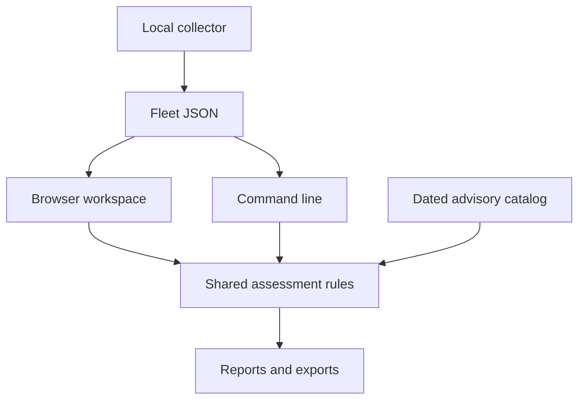

# Version 1 architecture

This document describes the implementation contract. The README and work log record which checks have actually been run; this architecture is not a claim of production validation.

## Runtime and components

The application uses Node.js 20+ and browser ES modules with no runtime package dependencies. The optional local collector uses Python 3.9+ standard-library facilities. Inventory assessment happens locally.

| Component | Responsibility |
|---|---|
| `public/` | Browser inventory, evidence editing, assessment display, and exports. |
| `src/core.mjs` | Shared validation, assessment, demonstration data, CSV formatting, and HTML reporting. |
| `src/catalog.mjs` | Dated advisory scope, reviewed branches, fixed versions, and source references. |
| `bin/php-response.mjs` | Command-line input/output around the shared rules. |
| `scripts/serve.mjs` | Static, allowlisted delivery on `127.0.0.1:4380`. |
| `collectors/collect.py` | Read-only local inventory observations; no assertion about the active web runtime. |

The server does not expose a shell or a remote-management API. It binds to loopback and serves approved static paths. It is a local development and review interface, not a multi-user service.

## Data and trust boundaries

Fleet JSON is the interchange format. Inventory records describe customers, sites, environments, owners, version observations, evidence, and provider assertions. Imported strings are data, never executable markup. The validation contract limits size and record count and rejects or removes unknown fields.

The browser stores working data locally in its profile. This is persistence for convenience, not an encrypted secret store or an access-controlled evidence repository. Export the inventory JSON when a durable or transferable working copy is needed. Report JSON contains derived assessment data; keep the original inventory as the editable record.

The collector runs only where the operator chooses to run it. A local CLI version is not the web runtime, and installing a package is not proof that existing workers have restarted. The collector must preserve those distinctions.

Provider confirmation is an operator-recorded assertion with a reference, reviewer, date, and explicit coverage of both CVEs. The application does not fetch the reference, sign the evidence, or perform remote attestation. The local clock and operator input are trusted inputs; deliberately false records can produce misleading reports.

## Assessment model

There are four outcomes: action required, verification needed, evidence complete, and provider confirmed. The last two describe distinct evidence paths. Neither certifies a secure environment.

Positive outcomes require a current catalog and timely, complete records. Upstream completion also requires a recognized stable version, a web-runtime observation, a reviewer and supporting evidence, restart confirmation, and a subsequent smoke check. The chronology is `restart <= observation <= smoke check`. Vendor or unknown versions do not pass a naive numeric comparison.

The catalog is deliberately finite. New branches, expired review data, future timestamps, and missing observations retain uncertainty. Reports include their generation time, scope, and unresolved actions.

## Outputs and operational limits

HTML reports escape imported values and restrict clickable references to allowed HTTP(S) URLs. Client-specific reports must contain only the selected client's data. CSV protects cells that spreadsheet applications could interpret as formulas. JSON preserves the structured inventory for later review.

There is no automatic patching, discovery scan, exploit execution, credential storage, external validation call, analytics service, or automatic catalog download. Following an external reference is a separate user action. Production patching and application testing happen outside the tool under the operator's change process.
