# A working response, from inventory to customer handover

**All customers, sites, operator entries, provider statements, and operational evidence in this walkthrough are fictional.** The screenshots were captured from the running application while an automated browser performed the actions below. The source dialog shows the application's dated advisory catalog.

The result is **16 captured scenarios, each accompanied by executable assertions**, including an actual downloaded HTML report opened in a separate browser tab. This establishes observed application behavior. Customer demand, willingness to pay, operator accuracy, and real remediation outcomes require the separate work described in the [hypothesis ledger](HYPOTHESES.md).

## Capture conditions and evidence

| Setting | Recorded value |
| --- | --- |
| Browser | Chromium 131.0.6778.0 |
| Automation | Playwright 1.62.1 |
| Standard browser clock | Fixed at `2026-10-22T14:00:00.000Z` |
| Expiry scenario clock | Fixed at `2026-10-29T00:59:59.000Z` in a separate browser context |
| Timezone | UTC |
| Desktop viewport | 1440 × 1000 |
| Mobile viewport | 390 × 844 |
| Report viewport | 1120 × 1100 |
| Initial inventory | Eight fictional sites, four fictional customers |
| Capture outcome | All 16 scenarios passed; zero JavaScript/CSP console errors; zero external requests |

The clock setting belongs to the **test browser only**. The production application continues to use the device's actual clock. A fixed date keeps the demonstration reproducible within this catalog's review window; the final scenario deliberately moves beyond its expiry. The harness changes records through the real forms and import dialog. It does not inject status labels, replace the assessment engine, or alter the application source.

Images are unretouched Chromium screenshots. Wide scenes use the browser viewport. Dialogs and the filtered inventory use native element screenshots so text remains readable. The mobile images capture the actual 390-pixel viewport. Some dialogs are cropped away from the main demo banner; their customer and evidence records remain fictional.

Evidence files:

- [Executable walkthrough](../scripts/capture-walkthrough.mjs)
- [Capture manifest, assertions, dimensions, and SHA-256 checksums](assets/walkthrough/manifest.json)
- [Actual downloaded fictional client report](../examples/walkthrough/client-report.html)
- [Fictional inventory import used in the merge scenario](../examples/walkthrough/inventory-update.json)
- [Broader validation results](VALIDATION.md)

## 1. Begin with an accountable inventory

**Fictional demonstration.** The default workspace has eight sites across four customers. The browser asserted the four counts: **2 action required, 3 needing verification, 2 with complete evidence, and 1 with a provider assertion**. The demo banner is visible before any edits.

This supports the basic workflow hypothesis: an operator can see unresolved work without opening every record. The counts describe these supplied records; they do not measure an independently discovered fleet.

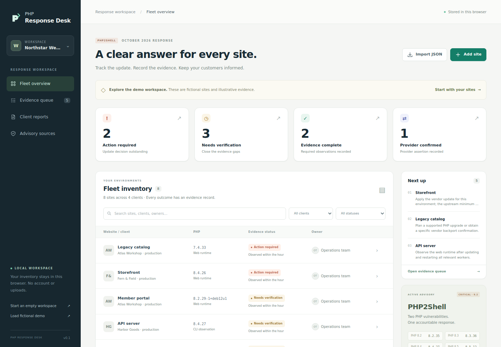

## 2. Open the evidence queue

**Fictional demonstration.** Selecting **Evidence queue** returns the five records with action-required or verification-needed outcomes. The harness checks both the number of rows and the absence of completed/provider-confirmed rows from this view.

The right-hand next-action list provides a place to begin. This verifies queue membership and navigation; prioritization still depends on an operator's knowledge of business importance and exposure.

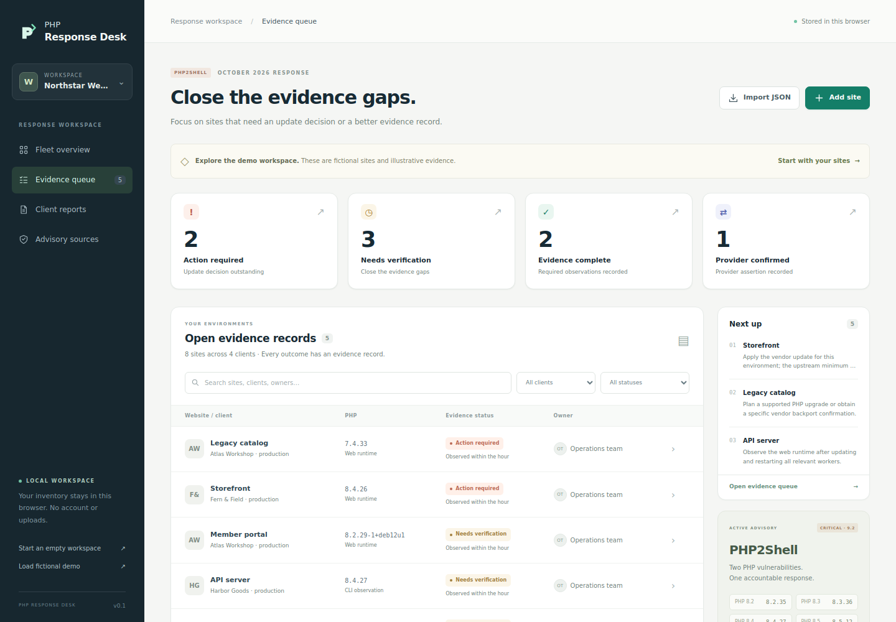

## 3. Focus on one customer

**Fictional demonstration.** The operator selects **Fern & Field**. Two environments remain: an outdated storefront and a booking portal with complete recorded evidence. The table and its visible count agree, and the harness checks that the other three customers are absent from the rows.

This is a filter in a single-user workspace. The separate report test below checks that the exported file itself also excludes other customers.

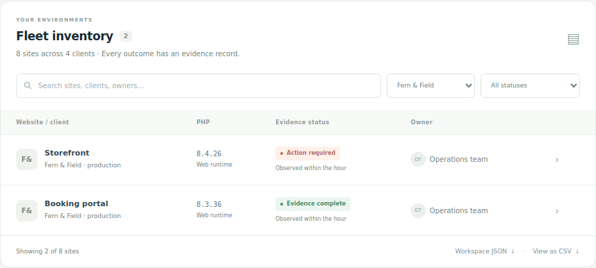

## 4. Inspect an outdated runtime and its action plan

**Fictional demonstration.** Opening **Storefront** shows an action-required record for upstream PHP `8.4.26`. The drawer identifies `8.4.27` as this catalog's minimum for the branch and asks for a worker restart, active-runtime observation, and application check.

The script asserts the recorded version, the outcome, and the fixed-version reference in the action plan. No update command is executed against a server.

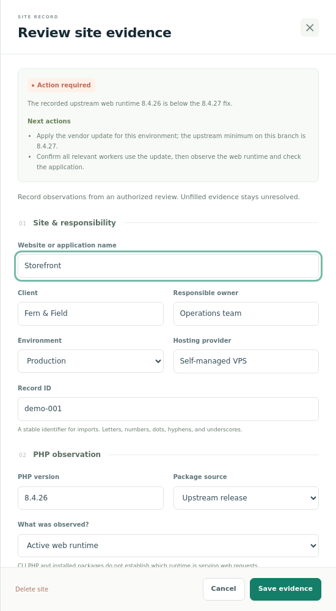

## 5. Save a patched CLI version while evidence remains incomplete

**Fictional demonstration.** The browser changes the version to `8.4.27`, selects **CLI PHP only**, clears restart/application-check timestamps, and saves an explanatory note. The saved record remains **Needs verification**.

This tests a consequential product hypothesis: recording a version that appears patched must not immediately produce a completed outcome. The live assessment and the stored record both retain the evidence gap.

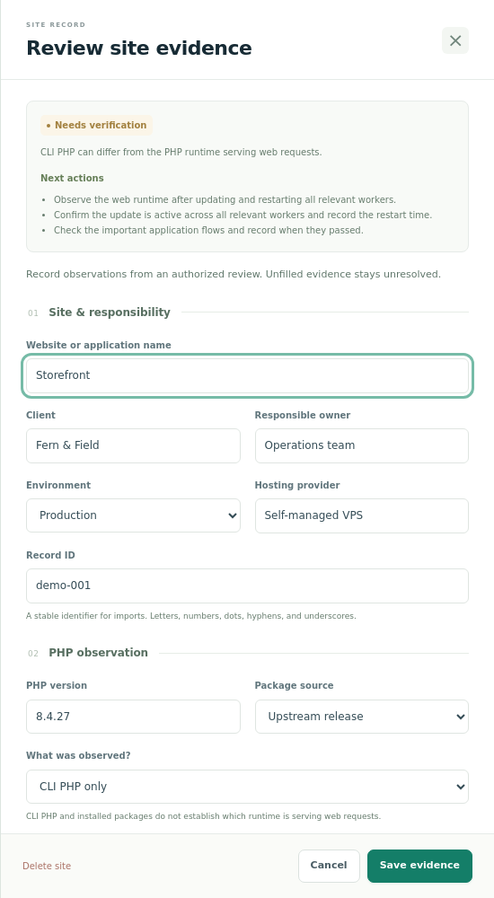

## 6. Complete the evidence record, save, and reload

**Fictional demonstration.** The operator now selects **Active web runtime**, enters a named demo reviewer, and supplies a clearly fictional evidence note. The timestamp sequence is explicit:

| Recorded event | Demonstration timestamp |
| --- | --- |
| Relevant workers restarted | October 22, 2026, 13:30 UTC |
| Active web runtime observed | October 22, 2026, 13:40 UTC |
| Application smoke checks passed | October 22, 2026, 13:50 UTC |

The script verifies the stored timestamps and the complete outcome, reloads the application, and reopens the record. **Evidence complete** survives the reload, and the workspace remains marked as a demo. This outcome means the supplied record meets the application's rules; no real runtime or checkout was tested in this walkthrough.

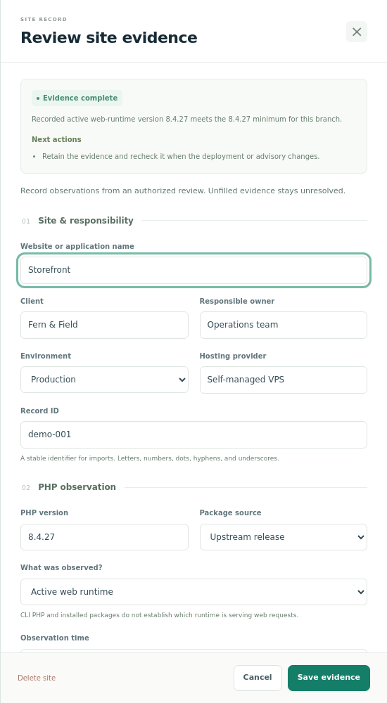

## 7. Keep a provider assertion identifiable

**Fictional demonstration.** The managed-hosting example opens as **Provider confirmed**. Its expanded evidence section records a timestamp, the `DEMO-482` reference, a demo reviewer, and explicit coverage of both catalog CVEs.

The browser checks the provider-confirmed outcome and the checked coverage field. This preserves the distinction between a provider's assertion and an operator's upstream web-runtime evidence. The screenshot is cropped to the assertion itself for legibility.

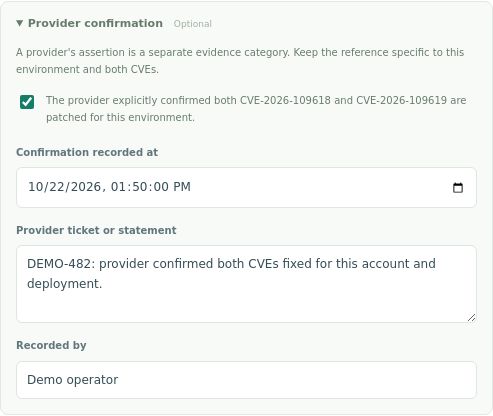

## 8. Preview and execute a merge

**Fictional demonstration.** The supplied [two-record inventory file](../examples/walkthrough/inventory-update.json) updates the owner of an existing API record and adds a seasonal microsite. The preview labels the file as demo data and offers **Merge sites by record ID**.

Before submission, the existing workspace is unchanged. After submission, the script verifies **nine total sites**, one instance of the updated ID, the new owner, and the original organization name. This demonstrates how repeat inventory collection can update a record without duplicating it.

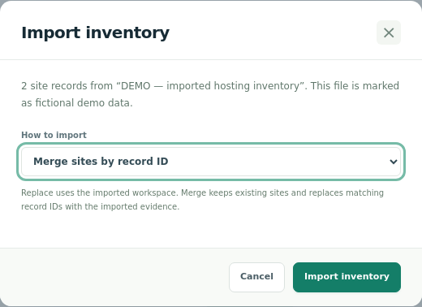

## 9. Reject a bad import without losing the workspace

**Fictional demonstration.** A second file declares unsupported `schemaVersion: 99`. The screenshot includes the actual rejection toast and the nine-site inventory count. A deep comparison verifies that the stored inventory is unchanged.

This tests failure behavior: an unusable import produces a visible error while preserving the current work. The [broader browser smoke check](../scripts/smoke-ui.mjs) additionally covers malformed JSON, oversized files, duplicate IDs, and literal rendering of untrusted fields.

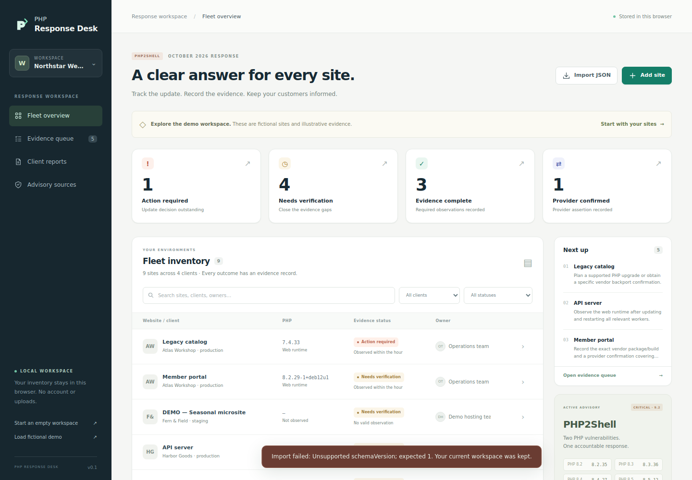

## 10. Choose a customer before exporting

**Fictional demonstration.** After the merge, Fern & Field has three sites. The operator opens **Create a client report** with that customer selected. The scope summary states **3 sites, 1 unresolved, fictional demo data** before download.

The script asserts all three parts of that summary. The unresolved microsite remains visible in the handover scope even though two other records satisfy the evidence rules.

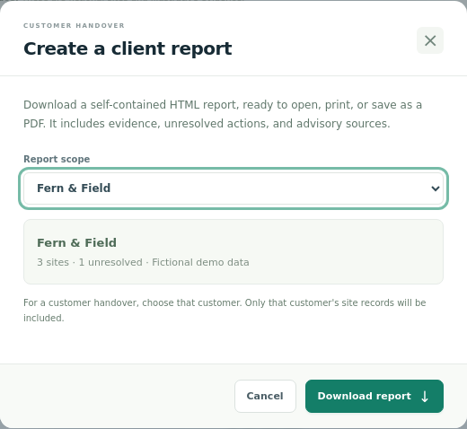

## 11. Open the actual downloaded report

**Fictional demonstration.** The browser clicks **Download report**, saves the resulting file, and opens that same HTML file in a new Chromium tab. This image is the rendered download, including its conspicuous demonstration warning.

The harness inspects both the file and its rendered contents. It asserts **exactly three Fern & Field records**, **two evidence-complete outcomes**, **one verification-needed outcome**, and **no Harbor Goods, Atlas Workshop, or Juniper Studio content**. The image shows the top of the report; the full [downloaded HTML](../examples/walkthrough/client-report.html) contains all three records and the interpretation/source section.

This supports the handover-file and customer-isolation hypotheses. Recipient comprehension, acceptance, and willingness to pay remain customer research questions.

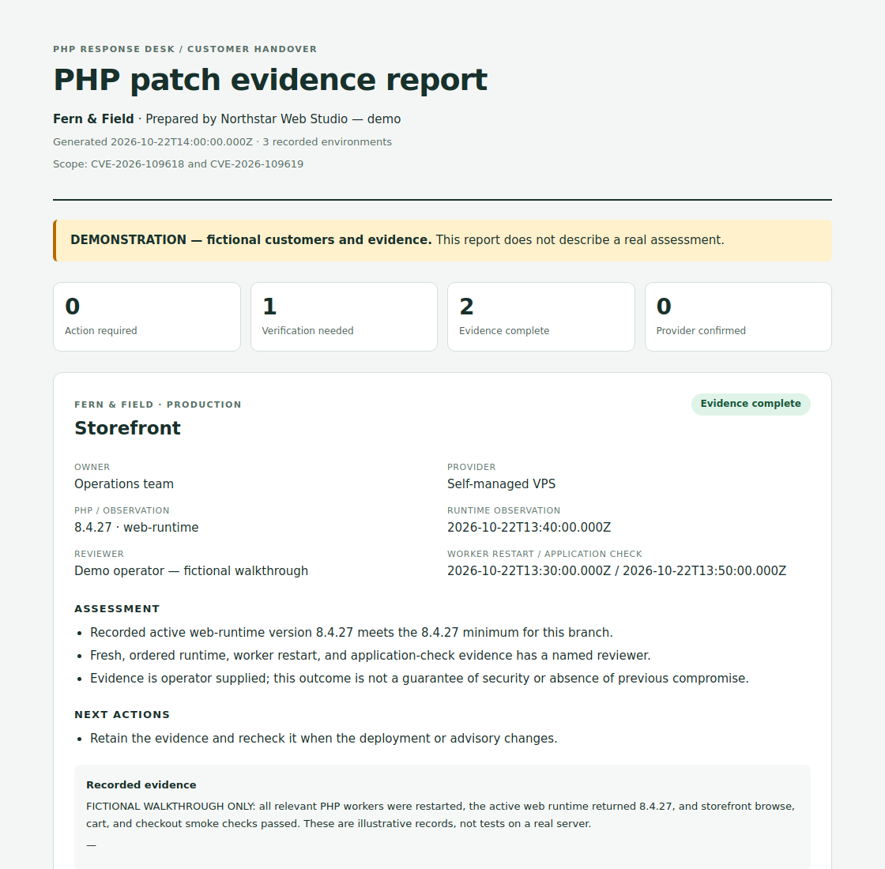

## 12. Start an empty workspace deliberately

The operator chooses **Start an empty workspace** and confirms the action. The resulting view has zero sites, zero positive outcomes, and an explicit prompt to add or import inventory. The script verifies that no demo record remains and that the workspace's demo flag is false.

This is an empty starting state for real work. An empty inventory does not establish that an organization has no affected systems. The demonstration records were removed rather than relabeled as actual customer evidence.

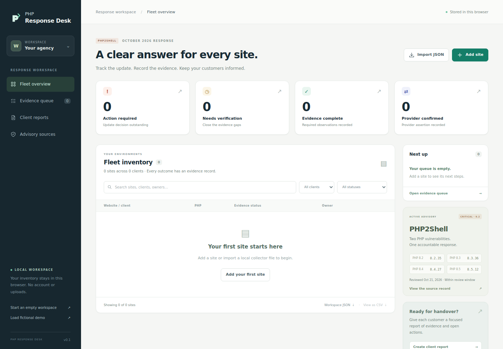

## 13. Inspect the advisory baseline

The source dialog exposes the catalog ID, review and expiry dates, 72-hour evidence window, CVE scope, four upstream minimum versions, and five primary references. The script checks the reference count, evidence window, and the PHP 8.4 minimum shown in the dialog.

This is the catalog shipped with this repository snapshot. Review its [source record](SOURCES.md) and current primary advisories before using it for a new operational decision. The application does not automatically refresh the catalog.

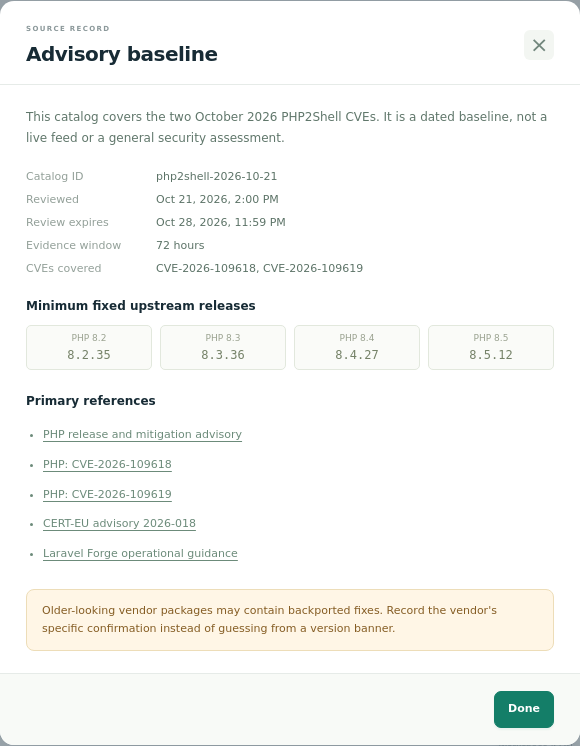

## 14. Use the overview on a small screen

**Fictional demonstration.** The demo is deliberately reloaded and the viewport changed to **390 × 844**. The overview retains its demo notice and all four status cards. The harness asserts that both the document and scrolling element fit the viewport width.

This validates the captured Chromium layout. It is a useful prerequisite for mobile use; usability on a person's device still needs observation.

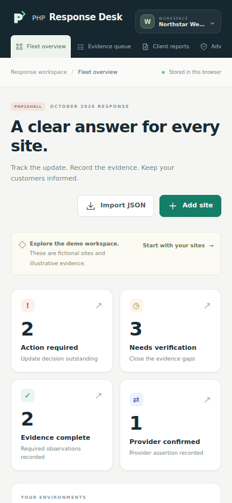

## 15. Edit and cancel on mobile

**Fictional demonstration.** The operator opens the storefront on mobile and types **Unsaved mobile demonstration**. The drawer fits the viewport, the body has no horizontal overflow, and Save/Cancel remain visible.

After this screenshot, the harness presses **Escape** and checks that the entire stored workspace equals its pre-edit value. The draft shown here was never saved. This verifies a specific cancellation path rather than inferring it from a static picture.

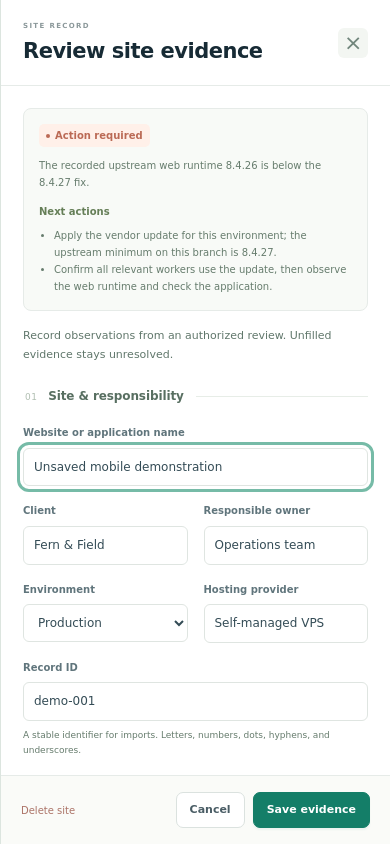

## 16. Let the catalog expire

**Fictional demonstration, separate controlled clock.** A new browser context runs at `2026-10-29T00:59:59.000Z`, one hour after this catalog expires. Its demo observations are otherwise freshly generated for that test time.

The application displays a review-required notice and reports **zero evidence-complete and zero provider-confirmed records**. The harness independently asserts the catalog's expired state and both zero counts. This tests that a stale source snapshot cannot continue issuing positive outcomes merely because individual evidence timestamps look recent.

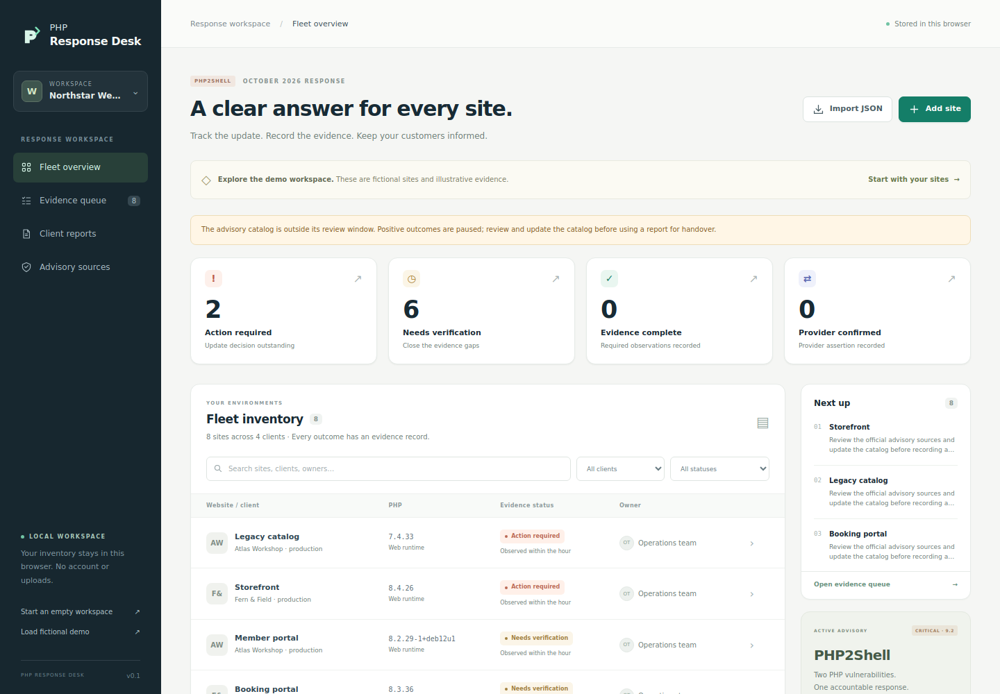

## Reproduce the capture

From the repository root, install the optional browser tooling outside the application directory. The application's runtime remains dependency-free:

```sh
npm install --prefix /tmp/php-response-walkthrough playwright@1.62.1
/tmp/php-response-walkthrough/node_modules/.bin/playwright install chromium
PLAYWRIGHT_MODULE_PATH=/tmp/php-response-walkthrough/node_modules/playwright \
  node scripts/capture-walkthrough.mjs
```

To use a separately installed Chromium executable, add `CHROMIUM_EXECUTABLE_PATH=/absolute/path/to/chromium`. The capture recorded here used Chromium **131.0.6778.0** with Playwright **1.62.1**. A different browser, font installation, or later catalog may produce different pixels or expected outcomes; the manifest records the actual browser, clock, catalog, image dimensions, and checksums for that run.

The script starts and stops its own loopback-only server, opens isolated browser contexts, writes the 16 PNGs and [manifest](assets/walkthrough/manifest.json), and saves the downloaded report and import fixture under `examples/walkthrough/`. Use `WALKTHROUGH_OUTPUT_DIR` and `WALKTHROUGH_EXAMPLE_DIR` to capture into other directories. Existing files with the same names are replaced by a new run.

Successful execution ends with:

```text
PASS All 16 screenshot scenarios; zero browser console errors; zero external requests.
```

The assertions and screenshots establish these specific software behaviors under the recorded conditions. They do not establish a patched real server, absence of compromise, a validated price, or customer demand. Those next experiments belong in the [hypothesis ledger](HYPOTHESES.md).
